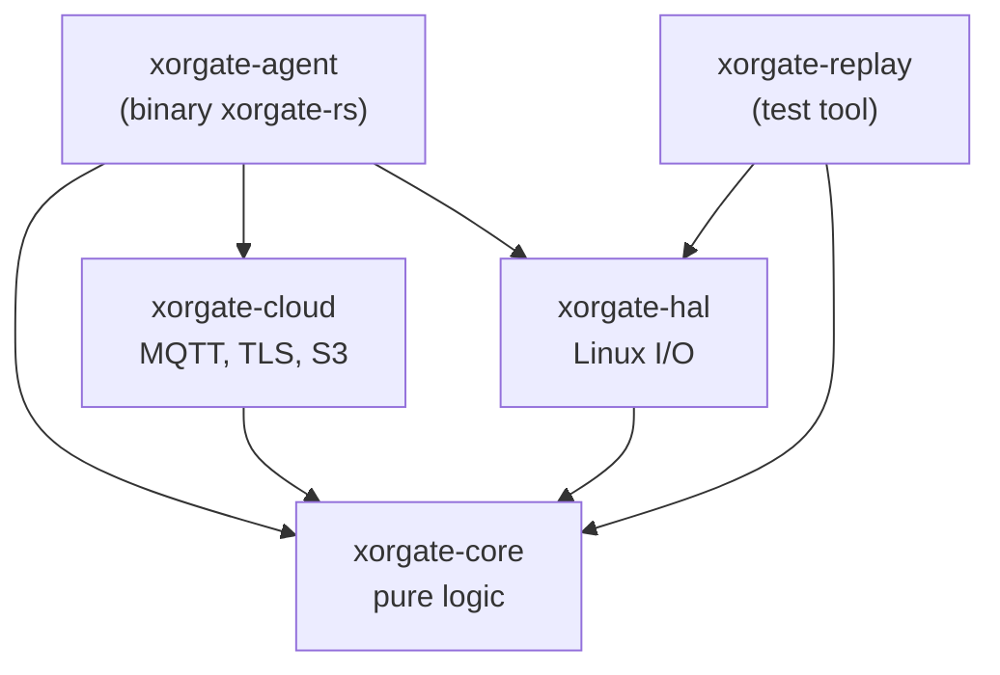

# 2. Workspace tour

## Cargo in two paragraphs

A **crate** is Rust's unit of compilation: a library (`src/lib.rs`) or a program (`src/main.rs`),
described by a `Cargo.toml`. A **workspace** is a set of crates built together, sharing one
`Cargo.lock` (the exact resolved version of every dependency) and one build directory. The root
`Cargo.toml` here lists the members and centralises versions:

```toml
# Cargo.toml:1-9
[workspace]
resolver = "2"
members = [
  "crates/xorgate-core",
  "crates/xorgate-hal",
  "crates/xorgate-cloud",
  "crates/xorgate-agent",
  "crates/xorgate-replay",
]
```

Each crate's own `Cargo.toml` then says `tokio = { workspace = true }` instead of repeating a
version, so all five crates always agree. Dependencies on other crates in the workspace work the
same way (`xorgate-core = { workspace = true }`). `cargo test -p <crate>` builds and tests one
member.

## The five crates

| Crate | Kind | Job | Size (src lines) |
|---|---|---|---|
| `xorgate-core` | library | **Pure logic.** Payload types and their exact JSON, parsers (NMEA, `vcgencmd` output, SMS PDUs, settings), every policy and decision (boot defer, load shedding, LED ladder, command handling, config merge and report). No I/O, no clock reads, no tokio. | ~29k |
| `xorgate-hal` | library | **Linux edges.** Reads `/proc` and `/sys`, runs tools with timeouts, the NMEA serial reader, the AT-command port, the GPIO LED driver, atomic file writes, child-process supervision, the record/replay tape writer. Decides nothing. | ~12k |
| `xorgate-cloud` | library | **AWS.** The MQTT 5 client over mutual TLS (rumqttc + rustls) with reconnect and offline-queue behaviour, the IoT credentials provider, a hand-written SigV4 signer and the S3 PUT. | ~3k |
| `xorgate-agent` | binary `xorgate-rs` (+ library) | **The runtime.** The worker that wires everything together, the MQTT/config/command planes, the collectors, recording, media, LED, clock stepper, SMS reader, and every CLI subcommand. | ~24k |
| `xorgate-replay` | binary `xorgate-replay` | **Test tooling.** Reads and synthesises tapes, plays a tape to two agents at once, and diffs their outputs under a tolerance table. Never shipped to devices. | ~32k |

Plus about 30k lines of tests, most of them in `crates/*/tests/`.

### How they depend on each other



`xorgate-core` depends on no other crate of the workspace, and nothing in it may do I/O. That rule
is enforced by a test, `crates/xorgate-core/tests/purity.rs`, which scans the crate's own sources
for `std::fs`, `std::process`, `tokio::`, `SystemTime::now` and similar, and scans its
`Cargo.toml` for banned dependencies.

### Why this split

- **Pure logic is easy to test against fixtures.** Most of the agent's behaviour is decisions
  ("should video stop now?", "what does the report say?"). Keeping those in `xorgate-core` as plain
  functions means a test can feed in an input recorded from the reference agent and compare the
  output, with no files, timers or network. The reference agent had the same split, which made the
  port mechanical.
- **Clocks are injected.** Core never reads the time. Functions take `now` as an argument, or a
  `&dyn Clock` (`crates/xorgate-core/src/clock.rs:13-18`). Tests then control time completely.
- **The I/O layer is thin and replaceable.** Every place where the outside world comes in is a small
  function or trait in `xorgate-hal`, so tests can substitute fakes and the record/replay rig can
  capture inputs at exactly that point.

## A pattern you will see everywhere: decide in core, act in the agent

Many subsystems split into a pure "decider" in core that returns a list of **effects**, and a small
interpreter in the agent that carries them out. The command plane is the clearest example:

- `xorgate_core::command_flow::decide_command` (`crates/xorgate-core/src/command_flow.rs:385`)
  takes the parsed command, the time, the replay ledger and the mode, and returns effects such as
  `PersistLedger`, `Log`, `Ack { status, reason }`, `Execute(..)`.
- `crates/xorgate-agent/src/command_plane.rs` walks that list and does each effect: write the file,
  log, publish the ack, run `sudo`.

The KVS live-video supervisor works the same way (`xorgate_core::media_ladder::MediaLadder` decides,
`crates/xorgate-agent/src/media/supervisor.rs` executes), and so do the capture ladder, the
uploader's retry steps and the updater (`xorgate_core::update_plan` decides, `cli/update.rs` does the
I/O). When you look for "why does it do X", look in core first.

## Other top-level directories

| Path | What |
|---|---|
| `fixtures/` | JSON test vectors ("golden fixtures") dumped from the reference agent, one folder per module, plus `config-contract.json` from the backend and the one committed replay tape. See chapter 5. |
| `systemd/` | `xorgate-agent-rs.service` (the agent) and `xorgate-updater-rs.service` (the one-shot updater); `systemd/bench/` holds a bench-only drop-in that is never installed on real devices. |
| `scripts/` | `docker-build.sh`, `pack.sh`, `build-info.sh`, the `dist-*.sh` publishing helpers, `install-rs.sh` (convert a device), `bench/` (bench-device helpers) and `tests/` (script test suites). |
| `tools/` | `replay/` (the record/replay rig: Docker compose, shims, tolerance table), and end-to-end rigs for conversion, update, OBD and SMS (`convert-e2e/`, `update-e2e/`, `obd-e2e/`, `sms-fake-modem/`). |
| `media/` | The vendored live-video runtime `xorgate-kvs-webrtc` (a C program) and its shared libraries. |
| `python/` | The IMU helper `bno085_read.py` (BNO085 and BNO086; the file keeps its name) and the OBD-II helper, run as supervised child processes. |
| `modem/`, `system/` | The LTE modem daemon and small sudo helpers. They ship in the tarball unchanged; the agent talks to them through files and `sudo -n`. |
| `docs/convert.md` | The operator runbook for converting a device to this agent and back. |

## Where to start reading

A good first pass, in this order, about two hours:

1. `crates/xorgate-agent/src/main.rs` (19 lines) and `crates/xorgate-agent/src/cli.rs`: how the
   binary dispatches subcommands.
2. `crates/xorgate-agent/src/worker.rs`, the function `run` (from line 508): the whole boot
   sequence, top to bottom, ending in the main `select!` loop. Chapter 4 walks through it.
3. `crates/xorgate-agent/src/ctx.rs`: `AgentCtx` (what every subsystem gets) and the traits the
   worker wires together.
4. `crates/xorgate-agent/src/mqtt_plane.rs`: connect handling and the 1 Hz publish tick.
5. `crates/xorgate-core/src/telemetry.rs`: the payload types and how they serialise exactly.
6. One collector end to end: `crates/xorgate-agent/src/collectors/lte.rs` (small), then
   `crates/xorgate-core/src/modem.rs` (`lte_group`).
7. One fixture test: `crates/xorgate-core/tests/cameras_fixtures.rs` (49 lines).

After that, pick the subsystem you need and read its module doc comment (`//!` at the top of the
file). They are long on purpose and explain the design and its constraints.
