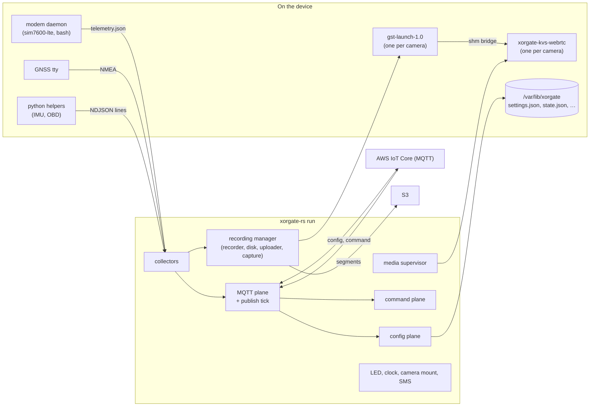
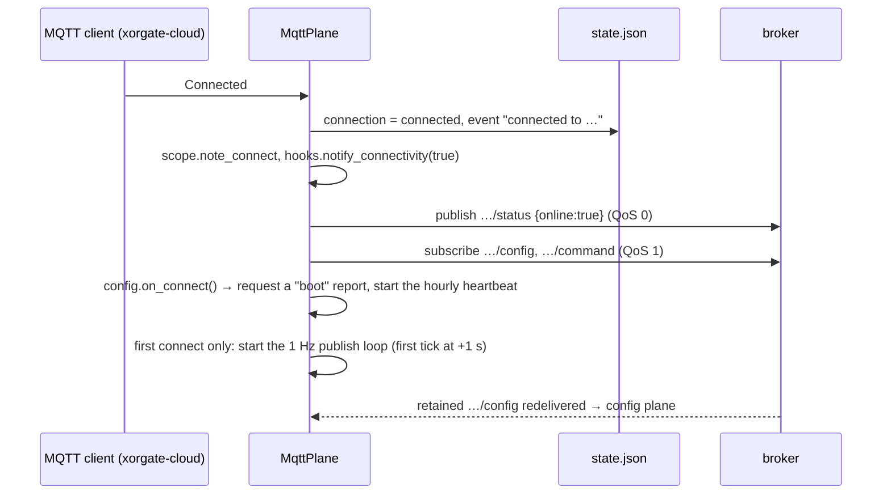

# 4. How the agent works

This chapter follows the agent from the moment systemd starts it to the moment it exits. Keep
`crates/xorgate-agent/src/worker.rs` open next to it: the function `run` (line 508) is the boot
sequence in order, and almost every step below is a few lines there.

## The big picture

The agent is **one process with one tokio runtime**. Each long-lived concern is a task that owns
its own state. Tasks talk through cheap shared handles (`StateHandle`, `MqttHandle`, `ScopeHandle`),
unbounded queues, and `watch` channels that publish "the current value". Anything that touches the
outside world goes through `xorgate-hal`, and anything that decides goes through `xorgate-core`.

## Startup

`main` (`crates/xorgate-agent/src/main.rs`) tunes the memory allocator before any thread exists
(see [chapter 9](09-gotchas-and-glossary.md#glibc-keeps-freed-upload-buffers)), then hands the
arguments to `cli::main`, which dispatches `run` to `worker::main`. That builds the tokio runtime and
runs `worker::run`, which does this, in order:

1. **Logging and identity.** `logging::init()` (journald under systemd, stderr otherwise),
   `build_info::load()` (from `build-info.json` next to the install).
2. **Configuration.** `env::load` reads the same environment keys as the reference
   (`/etc/xorgate/agent.env` via the systemd unit: `DEVICE_ID`, `IOT_DATA_ENDPOINT`, the cert paths,
   `MODE`, `RATE_HZ`, …) plus `--flag value` overrides. Then the TLS credentials are read, unless
   `--offline`. Any failure here exits 1, and systemd restarts the agent.
3. **GStreamer and home.** `gstreamer::init()` proves the shared library loads. `ensure_home` creates
   `XORGATE_HOME` (`/var/lib/xorgate` on a device).
4. **`state.json` and the context.** The initial `StateSnapshot` and the `AgentCtx` are built. The
   context holds the env, file paths, build identity, tape sink, state handle, hooks, the hardware
   block `watch`, the clock, the `CancellationToken` and the `TaskTracker`.
5. **Settings upgrades.** `config_plane::boot` runs one-time `settings.json` migrations before
   anything else reads the file.
6. **Hardware block.** `/etc/xorgate/hardware.json` says which board, encoder, cameras, IMU and LED
   this device has. It is loaded and published on `ctx.hardware`.
7. **Tape.** If `XORGATE_RS_TAPE` is set, a record/replay tape is opened (chapter 5).
8. **Media supervisor** (real mode with media enabled only), then the **hooks** objects that the
   recording, LED, clock and camera code hang off (see [Hooks](#hooks-how-the-worker-calls-subsystems)).
9. **Telemetry source.** Real mode starts the collectors; sim mode uses an empty `SimSource`.
10. **Pidfile** (`agent.pid`), then the first forced `state.json` write.
11. **Clock trust, privileged runner, hardware reconcile** (renders camera pipelines from the
    hardware block), **camera mount reconcile**, then the **recording manager** is built and
    started. Recording does not need MQTT: it runs offline too.
12. **Clock stepper** and **LED manager** (real mode).
13. **MQTT.** `connect` builds the TLS config and the client with its Last-Will. The
    **config plane** and **command plane** start, and the `MqttPlane` is created.
14. **Signals and timers**: SIGTERM, SIGINT, SIGHUP; a 1 s heartbeat, a 10 s "published N messages"
    log line, a 60 s camera-mount poll.
15. **`sd_notify(READY=1)`**, then the main `select!` loop (`worker.rs:837-874`).

## The main loop and the planes

The main loop does very little itself. Each `select!` branch hands an event to its owner:

| Event | Goes to |
|---|---|
| SIGTERM / SIGINT | breaks the loop: graceful shutdown, exit 0 |
| SIGHUP | ignored with a log line (a modem USB re-enumeration can raise it) |
| an MQTT event | `MqttPlane::on_event` |
| the recording manager's fatal channel | breaks the loop: shutdown, exit 1 |
| 1 s heartbeat | systemd watchdog ping, LED tick, `state.json` flush while not connected |
| 60 s | camera-mount reconcile |

A **plane** in this codebase is the agent's side of one MQTT conversation.

### The MQTT plane (`crates/xorgate-agent/src/mqtt_plane.rs`)

It reacts to the client's events in the reference's order. On **connect** (`on_connect`):

On **close** it marks the state `closed` and tells recording the device is offline (the uploader
pauses). On **reconnecting** it records the attempt. The MQTT client itself
(`crates/xorgate-cloud/src/mqtt.rs`) owns reconnection: a fixed 2 s pause between attempts, the
Last-Will re-stamped before each attempt, publishes made while offline queued and sent after the
next CONNACK, a 150,000-byte maximum packet size so a large retained config does not reset the
connection.

### The publish tick

Once a second (`PublishTick::run`, `mqtt_plane.rs:482-566`):

1. `source.read()`: one reading from every collector (groups with no data are left out).
2. Overlay the video-capture state onto the `media` block; take the recording status.
3. Build the `TelemetryPayload` with `seq` +1, add the LED leaves to the `system` group.
4. `state.set_latest(payload)`; check whether the OBD status changed (that requests a report).
5. **Clock trust gate.** Until the wall clock is trusted (NTP, or a GPS/modem time step), the
   publish is withheld for at most 5 minutes. `seq` still advances, so the cloud sees the gap.
6. Publish QoS 0 on the telemetry topic in force (`scope.topic()`: unscoped
   `xorgate/devices/<device-id>/telemetry`, or the tenant-scoped topic once the cloud has sent a
   scope).
7. When the client reports the payload written, count it in `state.json` (`published`).

A read error never crashes the agent: it becomes `lastError: "read error: …"` in `state.json`.

### The config plane (`crates/xorgate-agent/src/config_plane/`)

The cloud keeps the device's desired configuration as a **retained** message on
`xorgate/devices/<device-id>/config`, so it is redelivered on every connect. Messages go onto an
unbounded queue and one task handles them strictly in arrival order (`config_plane/mod.rs:185-216`).
`MessageHandler::handle` (`config_plane/message.rs:93-247`) then:

1. parses the message (malformed: log, event, stop);
2. handles three envelope facts **outside** the revision guard: `uploadBucket` (persisted into
   `kvs.json`), `scope` (the tenant telemetry topic), `hardware` (persisted to `hardware.json`,
   pipelines re-rendered);
3. applies the **rev guard**: a revision already applied is not applied again, except for
   namespaces this device has never stored, which are adopted once (`message.rs:185-193`). Otherwise
   `apply_cloud_config` re-reads `settings.json`, merges the namespaces
   (`xorgate_core::cloud_config::merge`) and writes the file atomically, but only if something
   changed;
4. on both paths, tells recording, OBD and the camera-mount reconciler to re-read their settings;
5. always records what it saw (`note_cloud_config`) and requests a report.

`ConfigSync` (`config_plane/sync.rs`) is the reporting half. It publishes `…/config/reported`
(QoS 1) with what is in force (`effective`) and per-namespace `status`, debounced by 2 s, plus an
hourly heartbeat report. It also polls a fingerprint of `settings.json` every 5 s, so a local edit
(`xorgate-rs set …`) is reported as a `local` change. Its bookkeeping lives in `config-sync.json`.

### The command plane (`crates/xorgate-agent/src/command_plane.rs`)

One-shot commands arrive on `…/command` (not retained). One task owns the decisions so that they
happen strictly in arrival order, while slow work (waiting for a PUBACK, running `sudo`, reading
SMS) runs in spawned tasks. Per message:

1. `parse_command` and `decide_command` (pure, in core) produce a list of effects.
2. **Expiry**: a command past its `expiresAt` (clamped to at most 120 s after it was issued) is
   rejected.
3. **Replay ledger**: the request ID is written to `commands.json` *before* executing, because
   `systemctl reboot` does not return. A duplicate is rejected.
4. **Ack** on `…/command/response` (QoS 1), waiting up to 3 s for the broker's PUBACK.
5. **Execute.** `reboot`, `power_off` and `update` run an exact `sudo -n systemctl …` argv
   (`update` starts `xorgate-updater-rs.service`). `refresh` (rate-limited to one per 30 s; reports
   now and again at +45 s), `read_sms`, `clear_sms`, `obd_scan` and `obd_forget` run in-process.

## Collectors and telemetry

Collectors live in `crates/xorgate-agent/src/collectors/`. Each implements the `Collector` trait
(`collectors/mod.rs:47-55`): a group name, `read()` for the live tick, and `sample()` for the
recorder, which recomputes at most once a second and remembers when its data last changed.

| Group | Collector | Source |
|---|---|---|
| `imu` | `imu.rs` | detects the BNO085 with `i2cdetect`, then supervises `python3 python/bno085_read.py`, which prints one JSON line per sample |
| `gps` | `gps.rs` | reads NMEA sentences from the GNSS tty (`GPS_NMEA_PORT`, default `/dev/ttyUSB1`); computes the fix, time-to-first-fix and a "sky state"; writes `gnss-sky.json` |
| `lte` | `lte.rs` | reads `/run/sim7600-lte/telemetry.json`, which the modem daemon rewrites atomically |
| `system` | `system.rs` | `/proc/stat`, `/proc/meminfo`, the thermal zone, `statvfs`, `vcgencmd get_throttled` and `pmic_read_adc`, the device tree's PSU limit |
| `obd` | `obd.rs` | only when the hardware block declares an OBD-II adapter: supervises `python/obd_read.py` |

Every collector **self-gates**: absent hardware gives an empty group and at most one warning, never
an error. The parsing and the exact field assembly (names, order, units, rounding) are pure
functions in core, for example `xorgate_core::system::system_group` and
`xorgate_core::modem::lte_group`.

## `state.json`

`state.json` in `XORGATE_HOME` is how the running agent tells other processes what it is doing.
`xorgate-rs status` and `manage` read it, and so does the device simulator host. It holds the
connection state and since when, `seq`, publish counters, the last error, the latest payload, the
last 20 activity events, the recording status and the OBD status
(`crates/xorgate-core/src/telemetry.rs`, `StateSnapshot`).

`StateHandle` (`crates/xorgate-agent/src/state.rs`) is the one writer. Writes are atomic (write a
temp file, fsync, rename, fsync the directory: `crates/xorgate-hal/src/atomic_write.rs`) and
throttled to one every 250 ms unless forced. Events (`ctx.state.note(level, msg, now)`) force a
write. A failed write is logged and ignored: the state file is never worth stopping the agent.

`agent.pid` is a small JSON record (pid, start time, argv) for the CLI, written when the agent is
not managed by another supervisor.

## Recording and upload

`crates/xorgate-agent/src/recording/` is the biggest subsystem. `RecordingManager`
(`recording/manager.rs`) is the single entry point. It re-reads the `recording` settings every 5 s
and on every config message, and owns these components:

- **Telemetry recorder** (`recording/telemetry.rs`): writes samples as JSON lines into gzip segments,
  `recordings/telemetry/<session-id>/seg-<ms>-<seq>.jsonl.gz`, rotating on size and age.
- **Video capture** (`recording/capture/`): one supervised `gst-launch-1.0` child per camera that
  owns the camera. In record mode the pipeline tees frames into an H.264 encoder that writes
  roughly 60 s MP4 fragments, and into a low-resolution shared-memory "bridge" that the live-video
  process reads. With recording off it runs the bridge only. Each fragment gets a JSON **sidecar**
  (`NNNNN.json`) describing it. The supervisor restarts crashed children with backoff (2 s doubling
  to 30 s), parks a camera after three quick deaths (retry every 60 s), and kills a child that wrote
  nothing for 45 s.
- **Disk manager** (`recording/disk.rs`): quota and retention, and `counters.json`
  (`droppedSegments`).
- **Uploader** (`recording/uploader.rs`): a single-flight queue to S3 while online and
  `upload.mode` is `auto`. Telemetry first, then video, oldest first. A video fragment uploads its
  sidecar first, then the MP4, and the local files are deleted only after both PUTs succeed. On
  failure it backs off from 2 s to 5 min. Going offline aborts the in-flight PUT.
- **S3 client** (`crates/xorgate-cloud/src/s3.rs`, `sigv4.rs`, `iot_creds.rs`): short-lived AWS
  credentials from the IoT credentials endpoint over the device certificate, then a hand-signed
  (SigV4) PUT. No AWS SDK: the agent needs exactly one operation.

At boot the manager finishes what a crash left behind: it finalises orphan telemetry segments,
closes orphan video sessions, and removes `/dev/shm` areas of dead capture children. Session IDs
are UUIDv7 (time-ordered). S3 keys are `telemetry/v1/<device-id>/<session-id>/…` and
`media-sessions/v1/<device-id>/<stream-key>/<session-id>/NNNNN.{json,mp4}`
(`crates/xorgate-core/src/upload_keys.rs`).

## Media: live video (KVS)

`crates/xorgate-agent/src/media/` supervises one `xorgate-kvs-webrtc` process per camera channel
listed in `kvs.json`. That is a vendored C program (in `media/`) that speaks AWS Kinesis Video
Streams WebRTC, so the console can watch the camera live. The agent does not move video itself:
the capture child writes frames into the shared-memory bridge (`shm/<stream-key>.sock`, fixed caps
`I420 1280x720 15/1`) and the KVS master reads them.

The supervisor (decisions in `xorgate_core::media_ladder`):

- starts masters lazily, on the first publish tick;
- always drains their stdout and stderr (a full pipe would block the master) and logs them as
  `[media <channel>] …`;
- stops them with SIGINT, restarts crashes with a ladder, parks a crash streak with a slow retry;
- bounces a master whenever its capture child respawns, so it reconnects to the new socket;
- parks every master when power shedding says so, and holds down masters of disabled cameras.

`media/reconcile.rs` renders the pipeline files in `/etc/xorgate/pipelines` from the hardware block,
and its verdicts feed a **stream guard** that stops a master from starting on a camera that is not
there.

## Power, load shedding and the LED

Two independent policies in `crates/xorgate-core/src/boot_policy.rs` decide whether the heavy video
encoders may run:

- **Boot defer** (one-shot). On a weak power supply, video waits for the modem to settle after boot
  (stage 1), and optionally for GPS or LTE (stage 2, the "GPS gate"). Once allowed, it stays allowed
  for the life of the process.
- **Load shedding** (reversible). Fed about one power sample a second (throttle bits, the 5 V rail,
  CPU temperature). **Rung 1** parks live video. **Rung 2** also stops video recording, but only for
  a power cause: thermal shedding never goes past rung 1. Telemetry recording is never shed.

Their verdicts appear in the telemetry `recording` block (`bootDefer`, `powerShed`, and `liveBlock`
while live video is blocked). Live video is parked in exactly **one place**, the recording
manager's `apply_video` (`recording/manager.rs:1033-1068`), so `liveBlock` always matches what
actually happened.

The **status LED** is a renderer, not a policy. `xorgate_core::led_state::resolve_led_state` ranks
facts other modules already published (connection, recording, GNSS, LTE, power) into a colour and
pattern. `crates/xorgate-agent/src/ops/led.rs` ticks it from the 1 s heartbeat and adds the two white
"config applied" flashes. `crates/xorgate-hal/src/led_driver.rs` drives the pins through the GPIO
character device. The systemd unit's `ExecStartPre` and `ExecStopPost` hooks (`xorgate-rs led boot`,
`led exit-state`) set the LED before the agent starts and after it stops; a crash leaves it solid
red. The resolved state is also published as `system.led_state` and `system.health_flags`.

## Other operations (`crates/xorgate-agent/src/ops/`)

- **Clock trust** (`clock_trust.rs`) holds the live publish and the recorder until the wall clock is
  trustworthy, for at most 5 minutes.
- **Clock stepper** (`clock_stepper.rs`): with no NTP, it steps the clock from GPS or the modem's
  network time through a sudo helper (`system/xorgate-setclock`), with a per-boot step limit.
- **Camera mount** (`camera_mount.rs`): makes the camera overlay line in the boot config agree with
  `cameraMount`, which says how the camera is MOUNTED: device-tree rotation = the overlay's default
  rotation (from the sensor catalog, `crates/xorgate-core/data/camera-catalog.json`) + the mount.
  It writes through the camera-line owner, a sudo helper (`system/xorgate-camcfg`), and only when
  the port's line gives another rotation than the one wanted. It never edits a line it cannot
  stand behind (two lines on one port, a `[section]` it cannot evaluate, a port whose sensor the
  kernel and libcamera do not confirm). It never reboots; it reports `rebootRequired`.
  (`system/xorgate-camrotate` is the JS agent's helper: still shipped, no longer called.)

  The same pass also applies **the sensor setting**, `cameraSensors`. A port with an entry there is
  *managed*: the pass makes the port's line the declared sensor's line with ONE helper call, or
  deletes it with `remove` for a port declared `none`, and writes nothing when `config.txt`
  already says it (`camera_sensors::line_op`). A port without an entry is unmanaged and goes
  through the rotation-only path above, unchanged.

  The rule behind "which call": **never lose a hand-set parameter silently.**
  - *The line already names the declared sensor's overlay.* An option the entry does not name is
    "as found": whatever the line has for it stays. An option the entry names is enforced (its
    default included). Nothing to enforce differs: no call. Only the rotation differs: `rotate`,
    in place, which keeps every token. A named option differs: one `set` with the named options
    plus the line's own un-named catalog options. But if that `set` would drop a token the
    catalog does not list for the overlay (`4lane`, `mono`, …), nothing is written and the port
    is `rejected` with a sentence that names the token.
  - *The line names another overlay (a sensor change), or there is none.* One `set`: the
    catalog's fixed parameters, the named options, the overlay's defaults for the rest. The old
    line's tokens were the old sensor's.

  "What runs on the port" (to tell a booted line from a pending one) is read from the live device
  tree and the pass's camera listing, never from the `<key>.camera` cache file: that file is only
  rewritten when a camera IS listed, so it outlives the camera. What cannot be applied (a port the device does
  not have, a sensor or option this build's catalog lacks, a malformed entry, a helper refusal) is
  refused for that one port, with a sentence in `status.cameraSensors`; the other ports are still
  applied.

  One pass, two statuses: `cameraSensors` (the line) and `cameraMount` (the rotation). Neither says
  `applied` for a line that is written and not booted. To know, the agent keeps each port's line as
  it first saw it in the current boot (`<home>/camera-boot-lines.json`, keyed by the kernel's boot
  id): a line that differs now waits for a reboot. The per-port camera report uses the same record
  for its `reboot-required` verdict.

  The installer writes the first lines with the same code: `xorgate-rs camera apply --from-claim
  <file>` (`cli/camera.rs`), run as root by `scripts/provision-rs.sh` step 8b.
- **SMS reader** (`sms.rs`): reads stored SMS over the modem's spare AT port without marking them
  read, for the `read_sms` command and `xorgate-rs sms`.

## Hooks: how the worker calls subsystems

The worker has many "call sites" where the reference called into recording, the LED, the clock
stepper or the camera reconciler: on connect, on close, after a config message, at shutdown. In the
Rust agent each call site is a method of the `PhaseHooks` trait (`crates/xorgate-agent/src/ctx.rs:378`),
and every method has a do-nothing default. `NoopHooks` implements none of them. The real
implementation is `OpsHooks` (`ops/hooks.rs`), which wraps `RecordingHooks` (`recording/hooks.rs`).
The name is historical: the hooks were filled in subsystem by subsystem while the port was built.
Today they are simply the seam between the worker and the subsystems, and the seam tests use to
watch the order of calls (`FakeHooks` in `tests/common/mod.rs`).

## Shutdown

On SIGTERM or SIGINT the loop breaks and `Shutdown::run_with`
(`crates/xorgate-agent/src/shutdown.rs:130-196`) runs the reference's sequence:

1. cancel the token (every loop and timer stops), log `shutting down (SIGTERM)…`;
2. stop the LED and the config plane, stop recording (finalising the open segment), stop the
   collectors' children, remove the pidfile, mark `state.json` closed;
3. if connected, publish `…/status {online:false}` and end the MQTT session with a DISCONNECT,
   within a 2 s budget. The broker then discards the Last-Will.

Then, in `worker::run`: the OBD helper gets a bounded close, the task tracker gets at most 500 ms,
capture children still finishing are killed and their `/dev/shm` areas removed, the tape is closed,
and the agent sends `STOPPING=1` and exits.

Where the reference would have **crashed** (for example the recording finalize failing), the Rust
agent still cleans up locally, but skips `online:false` and drops the connection **without**
DISCONNECT, so the broker publishes the Last-Will (`online:false` with the connect-time timestamp),
exactly as the cloud saw before. The exit code is 1 and systemd restarts the agent.

## systemd and the watchdog

`systemd/xorgate-agent-rs.service` runs `/opt/xorgate-rs/bin/xorgate-rs run` with
`Type=notify`, `WatchdogSec=60`, `NotifyAccess=main` and `Restart=always` (5 s pause; after ten
starts within 60 s systemd stops restarting it until an operator runs `systemctl reset-failed`).

- The agent sends `READY=1` once its planes are wired, then `WATCHDOG=1` from the 1 s heartbeat
  **whatever the MQTT state**. A device booting without network keeps reconnecting in peace, but a
  wedged main loop stops pinging and systemd restarts it after 60 s.
  `crates/xorgate-agent/tests/watchdog.rs` proves the pings continue while a connect hangs.
- `NotifyAccess=main` means only the agent's own PID may ping. Child processes must not even see
  the notify socket, which is why every spawn strips the systemd notify variables (chapter 5).
- `Conflicts=xorgate-agent.service` plus `After=xorgate-agent.service` make the Rust and the
  reference agent mutually exclusive, with the old one fully stopped before the new one starts. Two
  agents with the same device identity would kick each other off the broker forever.
