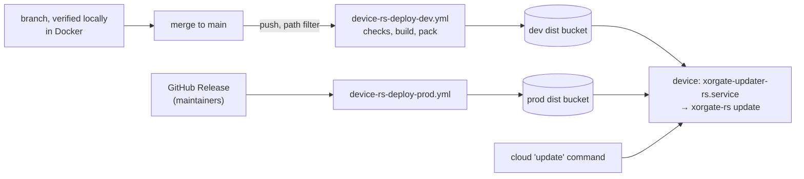

# 7. Build, package, deploy

How a commit becomes a running agent on a device.



## The release binary

`cargo build --release` uses the profile in the workspace `Cargo.toml`:

| Setting | Why |
|---|---|
| `lto = "fat"`, `codegen-units = 1` | whole-program optimisation: a smaller, faster binary, at the cost of slow release builds |
| `strip = true`, `debug = "line-tables-only"` | small binary, but panics and backtraces still name files and lines |
| no `panic = "abort"` | a panic unwinds, so a panicking task is caught and reported (`AgentCtx::spawn`) instead of killing the whole process |

The binary links GStreamer and glibc dynamically (chapter 1). CI prints the relevant
`ldd target/release/xorgate-rs` lines after every release build so this stays visible.

## Build identity: `build-info.json`

`scripts/build-info.sh <channel> [--version <v>] [--out <path>]` writes
`{"version", "channel", "builtAt", "packageVersion"}`. The agent reads it from `../build-info.json`
next to its executable, reports it in the config report as `effective.agent.build`, and prints it
with `xorgate-rs -v`. The console compares `version` as a plain string with the latest published
build.

| Channel | Made by | `version` |
|---|---|---|
| `dev` | the deploy-dev workflow, for `main` | short commit sha |
| `prod` | the deploy-prod workflow, for a release | the release tag |
| `bench` | `scripts/docker-build.sh pack`, by hand | short sha, `-dirty` if the tree has changes |
| `ci` | `ci.yml` artifacts | never published |

Without a `build-info.json` the binary falls back to the commit baked in by `build.rs` and channel
`dev-local` (`crates/xorgate-agent/src/build_info.rs`).

## `scripts/pack.sh` and the tarball

```sh
scripts/docker-build.sh pack       # build in Docker, then pack with channel bench
# or, with an existing binary:
scripts/pack.sh --channel bench --bin target/docker/release/xorgate-rs
```

Output: `target/dist/xorgate-agent-rs-<version>.tar.gz` and a `.sha256` sidecar in
`sha256sum -c` format. The tarball is laid out exactly as `/opt/xorgate-rs` on the device:

```text
bin/xorgate-rs           the stripped release binary
build-info.json
systemd/                 xorgate-agent-rs.service, xorgate-updater-rs.service (+ bench/, never installed)
install-rs.sh            the converter, so --revert works offline
python/                  the IMU and OBD helpers
modem/                   the modem daemon and its udev/NetworkManager files
media/                   the KVS WebRTC runtime and its libraries
system/                  the sudo helpers and a cron file
```

`pack.sh` refuses to produce a tarball that misses a required member (the binary, the unit, the
Python helpers, `install-rs.sh`), and it verifies the vendored `media/`, `modem/` and `system/` trees
against their `SHA256SUMS` files. A corrupted binary blob then fails the pack, not the first live
view on a device.

## CI workflows (`.github/workflows/`)

Every build job runs on an `ubuntu-24.04-arm` runner inside `container: debian:bookworm`, for the
same reason the local build uses Docker: native aarch64, glibc 2.36, GStreamer 1.22. (Only the
`cargo deny` job runs on a plain x86 runner: it just reads `Cargo.lock`.)

| Workflow | Trigger | Does |
|---|---|---|
| `ci.yml` | **manual only** (`workflow_dispatch`) | fmt, clippy `-D warnings`, tests, the Rust-vs-Rust replay smoke and media smoke, release build, `pack.sh --channel ci` (artifact only), and a separate `cargo deny` job |
| `device-rs-deploy-dev.yml` | push to `main` touching shipped paths (`crates/`, `Cargo.toml`, `Cargo.lock`, `rust-toolchain.toml`, `systemd/`, `scripts/` except `scripts/bench/`, `python/`, `modem/`, `media/`, `system/`, or the workflow file itself; Markdown never triggers it). Also has a manual `workflow_dispatch`. | fmt, clippy, tests, release build, `build-info.sh dev`, pack, upload to the **dev** dist bucket, then an anonymous check of what a device will see |
| `device-rs-deploy-prod.yml` | a **published GitHub Release** (also a manual `workflow_dispatch` with a `tag` input) | the same checks at the tag, `build-info.sh prod --version <tag>`, pack, verify the AWS account, upload to the **prod** dist bucket |

`ci.yml` is manual to save CI minutes: branches are verified locally in Docker before merge, and
`main` is covered by the deploy workflow, which runs the same checks before it publishes anything.
So **a merge to `main` that touches shipped code is a deploy to dev.** Releases and production
deploys are done by the maintainers. **Never dispatch `device-rs-deploy-dev.yml` or
`device-rs-deploy-prod.yml` by hand**, and do not create releases. Dispatching `ci.yml` on a branch
(`gh workflow run ci.yml --ref <branch>`) is harmless, since it uses no secrets and publishes
nothing, but it costs CI minutes: ask first.

What gets uploaded, and the guard rails:

- The versioned tarball and its sidecar (cached forever), the `xorgate-agent-rs-latest.tar.gz`
  alias and sidecar, `install-rs.sh` and its sidecar, and `latest-rs.json` last.
- Every key goes through `scripts/dist-guard.sh`, an allow-list of the Rust agent's keys only. The
  same buckets hold the reference agent's builds (`latest.json`, `xorgate-agent-*.tar.gz`), and the
  guard makes it impossible for this repo to overwrite them.
- `latest-rs.json` is produced by `scripts/dist-manifest.sh`, whose output bytes are frozen and
  tested (`scripts/tests/dist.sh`).
- `scripts/dist-check.sh` then fetches everything anonymously, as a device would, checks every
  sidecar, and confirms the reference agent's `latest.json` did not change.

## On the device

| Path | What |
|---|---|
| `/opt/xorgate-rs/` | the unpacked tarball |
| `/usr/local/bin/xorgate-rs` | a two-line wrapper: sets `XORGATE_HOME=/var/lib/xorgate` by default and execs the binary, so the CLI reads the running service's state |
| `/etc/systemd/system/xorgate-agent-rs.service` (+ `.d/10-user.conf`) | the agent unit, run as the provisioning user |
| `/etc/systemd/system/xorgate-updater-rs.service` (+ `.d/10-dist.conf`) | the one-shot updater |
| `/etc/sudoers.d/024_xorgate-update-rs` | lets the agent start exactly the updater unit, nothing else |
| `/usr/local/bin/xorgate-camcfg` (+ `xorgate-camcfg.overlays`) | the camera-line owner: the root helper through which the agent changes the camera `dtoverlay=` lines of `config.txt`, and its allow-list: the overlay names it may write and, per overlay, the parameter names (generated from the sensor catalog). It builds every line itself from checked parts and never reboots |
| `/etc/sudoers.d/025_xorgate-camcfg` | lets the agent run that helper, nothing else |
| `/var/lib/xorgate/camera-boot-lines.json` | each camera port's `dtoverlay=` line as the agent first saw it in the current boot (keyed by the kernel's boot id). A line that differs now waits for a reboot. Rust-only; rewritten once per boot; safe to delete |
| `/var/lib/xorgate-packages/` | root-owned, 0755, checked before use. `camera-packages.json` (0644): which extra OS packages `xorgate-rs camera requirements --install` installed for a camera sensor, the versions they replaced and the holds it set (for a rollback by hand). `lock`: held while an install runs. `download-XXXXXX` (0700): exists while a download runs; one left by a killed run is removed by the next |
| `/etc/xorgate/` | identity, `agent.env`, manifests: shared with the reference agent, read-only for the converter |
| `/var/lib/xorgate/` | settings and state: shared with the reference agent |

## Converting a device: `scripts/install-rs.sh`

Devices are provisioned with the reference agent and then **converted**. `install-rs.sh` ships at
the root of every tarball and as a key in the dist bucket. The operator runbook is
[`docs/convert.md`](../docs/convert.md). The essentials:

```sh
sudo bash install-rs.sh [--from <bucket-url>] [--tag <ver>] [--tarball <file>] [--reinstall] [-y]
sudo /opt/xorgate-rs/install-rs.sh --status            # converted | converting | reverted | not-converted
sudo /opt/xorgate-rs/install-rs.sh --revert            # back to the reference agent; Rust files kept
sudo /opt/xorgate-rs/install-rs.sh --revert --purge    # … and delete what the conversion installed
```

- **Convert** downloads and verifies the tarball (or takes `--tarball` offline), smoke-runs the
  staged binary, installs only Rust-owned paths, records the previous state in
  `/var/lib/xorgate-rs-install`, then disables the reference agent's unit and starts the Rust one.
  If the Rust agent is not healthy after its start and a verification window (up to 150 s each),
  the script reverts by itself and exits 4.
- **Revert** needs no network and no working Rust binary. It restores the reference agent's
  enablement from the record, starts it, and compares the reference agent's files with the
  pre-conversion manifest.
- **Rollback is always possible** because the reference agent is stopped and disabled, never
  removed.
- It never touches `/etc/xorgate`, the reference agent's install and units, the modem daemon, or
  any file it did not install. It is plain bash with only the tools a Bookworm device already has.

Exit codes: 0 done, 1 failed (device back where it was), 2 usage, 3 refused (precondition), 4 the
Rust agent was unhealthy and the script reverted. `docs/convert.md` has the troubleshooting table.

Test it with `scripts/tests/install-rs-unit.sh` (fast, in a throwaway container),
`scripts/tests/install-rs-systemd.sh` (real systemd) and `tools/convert-e2e/` (the full matrix).

## The updater

The cloud's `update` command (or the console's update button) makes the agent run
`sudo -n systemctl start --no-block xorgate-updater-rs.service`. That one-shot unit runs
`xorgate-rs update` (`crates/xorgate-agent/src/cli/update.rs`), which:

1. downloads `xorgate-agent-rs-latest.tar.gz` and its `.sha256` (or `--tag <version>`, or
   `--from <bucket-url>`), and verifies the checksum;
2. unpacks it to `/opt/xorgate-rs.new` and smoke-runs the staged binary;
3. swaps it into `/opt/xorgate-rs`, keeping `/opt/xorgate-rs.old`, which is **restored
   automatically** if any later step fails;
4. reinstalls the units, the wrapper, the updater unit and the sudoers grant (and the shared modem
   and system assets only on a device that no longer has the reference agent);
5. reloads systemd and restarts the agent, only if it was running. **The update is complete
   here** ("updated to …");
6. then runs the NEW build's `xorgate-rs camera requirements --install --quiet --time-limit N`:
   the extra OS packages a declared camera sensor needs (next section). It prints nothing and
   takes no time when nothing is to do, it cannot undo or delay the update, and it restarts the
   agent once more itself only when it installed something.

All the decisions and every file body are in `xorgate_core::update_plan`; `update.rs` is only the
I/O, with a timeout on every tool it runs. It requires root. By hand:
`sudo systemctl start xorgate-updater-rs && sudo journalctl -u xorgate-updater-rs -n 50`.

One caveat from the runbook: `agent.env` may pin `DEVICE_DIST_VERSION` to a reference-agent build.
The updater unit's drop-in `10-dist.conf` overrides it to `latest`. A hand-run
`sudo xorgate-rs update` does not see that drop-in, so pass `--tag latest`.

Test it with `tools/update-e2e/run.sh`, which uses a local fake bucket.

### The extra packages of a sensor

Some sensors need OS packages the stock image does not have. Today that is one case: the IMX335
needs Arducam's libcamera build (two packages, `libcamera0.5` and `libcamera-ipa`, that replace
the stock ones of the same name). Which packages, in which version, from which URL, with which
sha256 and size is pinned in the sensor catalog (`crates/xorgate-core/data/camera-catalog.json`,
`packageSets`), per OS release and architecture. The catalog is compiled into the binary.

```sh
xorgate-rs camera requirements                 # anyone: what the declared sensors need, required and installed versions
sudo xorgate-rs camera requirements --install  # root: install what is missing, hold it, restart the agent
#   --from-claim <claim.json>   the sensors of a claim response instead of the held cameraSensors setting
#   --no-restart                do not restart the agent afterwards
#   --quiet                     print only what was changed or what failed
#   --time-limit <seconds>      finish within this time; the install itself is only started when
#                               it can finish inside it, and is never cut short
```

Exit codes: 0 nothing is needed or everything is in place; 1 something is missing (listing) or
an install did not succeed; 2 usage or an unreadable claim; 3 refused for this device (the
catalog lists no packages for its OS release and architecture, or an entry is not usable).

**The unprivileged agent never installs anything.** It reports `requirements-missing` with the
package names and "run `sudo xorgate-rs update` on the device (the console's Update button does
the same), or `sudo xorgate-rs camera requirements --install`". Three things run the install, all
as root: the provisioner (step 8c, with the claim, before the agent starts), `xorgate-rs update`
(step 6 above, so the console's Update button installs them), and a person at a shell. In the
first two a failure is a `WARN` line and nothing more: the device is as it was, and the next
update tries again.

What `--install` does (`cli/camera_packages.rs`; the plan and every check are in
`xorgate_core::camera_packages`, the download in `xorgate_cloud::fetch`):

1. **Takes the state directory** `/var/lib/xorgate-packages`: it must be a real directory (not a
   link), owned by root, that nobody else can write; it is created 0755 when absent and refused
   otherwise. The run locks it (a second run is turned away) and removes the `download-*`
   directories an earlier run left behind. The directory and its `lock` file (0600) are
   created as soon as a run finds work to do, also when it then refuses (not enough time, a
   busy dpkg) and changes no package.
2. **Refuses** in one sentence when the catalog has no packages for this OS release and
   architecture, or a pinned entry is not plain. Nothing is changed.
3. **Refuses before any download when dpkg was interrupted** (below).
4. **Downloads** each missing package over HTTPS from the catalog's URL into a new directory under
   the state directory that only root can read. The URL's host must be `github.com` (the
   backend's `CAMERA_PACKAGE_HOSTS`). GitHub answers a release-asset download with a redirect to
   its asset store, so a redirect is followed only to `github.com`,
   `release-assets.githubusercontent.com` or `objects.githubusercontent.com` (the store's earlier
   name), over HTTPS, at most four times; the HTTP library itself follows none. No credentials,
   no proxy, and never more bytes than the catalog's `bytes`.
5. **Verifies** size and sha256 against the pin BEFORE anything is installed. A file that is not
   the pinned one is refused, and the download directory is removed when the run ends, with
   two exceptions. A run that is KILLED cannot remove it. And it is never removed while the
   real install may still be alive: not by an early return, not by a panic, and not after an
   `apt-get` that had to be stopped at its 600 s bound (apt runs dpkg in a session of its own,
   which that stop does not reach). What is left is removed by a later run's sweep (step 1),
   which does not run while a package operation holds the dpkg lock. The directory is
   root-only and holds about 1 MB.
6. **Asks apt first**: `apt-get -s install <those files>` (a simulation) and reads the plan. It
   must be exactly the pinned packages in the pinned versions: every one of them, nothing else
   installed, nothing removed. Otherwise the install is refused before the system is touched.
7. **The transaction.** Installs exactly those files with `apt-get install`: the simulation's
   arguments without `-s`. They include `--no-remove` (apt aborts rather than remove a package,
   also if its view changed since the simulation) and dpkg's `--force-confdef --force-confold`
   (a changed configuration file keeps the local version without a question nobody could
   answer). Then the WHOLE dpkg database is read back: the pinned versions must be there, and a
   package outside the pinned set that changed during the install is reported loudly. What was
   replaced is written to `camera-packages.json` at once, also when apt failed half-way, so the
   way back always names versions that were there before. If the database cannot be read back
   after apt reported success, the line says "could not confirm", and the hold and the record
   are still written.
8. **Holds** the packages (`apt-mark hold`) when the set says so.
9. **Restarts the agent** (`systemctl try-restart`, so only if it runs) unless `--no-restart`:
   the camera is then listed within seconds. Without the restart it appears at the agent's next
   camera re-listing, at most five minutes later. The PACKAGES need no reboot either way, and
   the closing line says "no reboot is needed" unless a camera line of `config.txt` waits for
   one. That is asked of the agent's own record of this boot's camera lines
   (`camera-boot-lines.json`, the fact behind the port's `reboot-required`; it is only read):
   when a port's line differs from the one the device booted with, the closing line reads "the
   packages are in place and the agent was restarted, but a reboot is still needed: the camera
   line of cam0 in config.txt was changed since this device booted (sudo reboot)". The usual
   case is a port that was just set to the sensor: the agent wrote its line, and the update
   that installs the packages runs before the reboot. With no record of this boot (the agent
   has not run in it) nothing is said to be pending, as in the agent's own report. The
   provisioner (`--from-claim`) is not asked this: it has its own reboot notice.

It is idempotent: a set that is installed and held costs no download and no apt call. It never
runs a script of the package's vendor (Arducam's install script pulls in about 200 packages and
runs remote shell code), never adds an apt source, and passes no catalog string to a shell:
every tool is run with an argument vector and a fixed environment
(`PATH=/usr/sbin:/usr/bin:/sbin:/bin`, `DEBIAN_FRONTEND=noninteractive`, `LC_ALL=C`), by absolute
path (`/usr/bin/apt-get`, `/usr/bin/apt-mark`, `/usr/bin/dpkg-query`).

**Time, and why nothing can cut an install in half.** Every step has a bound (seconds,
`camera_packages::T_*`):

| Step | Bound | May it be cut short? |
|---|---|---|
| `apt-mark showhold` | 30 | yes |
| read the dpkg database (start) | 30 | yes |
| download, per file (two files) | 180 (connect 20, between reads 30) | yes |
| `apt-get -s install` | 90 | yes |
| read the dpkg database (before the install) | 30 | yes |
| **`apt-get install`** (apt's own wait for the dpkg lock, 120, included) | **600** | **no** |
| read the dpkg database back, `apt-mark hold`, `try-restart` | 30 + 30 + 90 | no (reserved) |
| the command at its worst | 1290 | |
| `--time-limit` a caller gives (`STEP_LIMIT`) | 1320 (22 min) | |
| the caller's backstop: the limit + 60 | 1380 | |
| the updater unit, `TimeoutStartSec` | 2700 (45 min) | |
| the updater unit, `TimeoutStopSec` (`KillMode=mixed`) | 900 (15 min) | |

- A step that "may be cut short" is ended by its bound and by a stop request (SIGTERM, Ctrl-C),
  and its tool is killed as a process group, so nothing it started is left running.
- The real `apt-get install` is the one exception. Once it has started, nothing in the agent's
  code ends it except its own 600 s, a last resort against an apt that hangs (two small packages
  take seconds). A stop request is noted ("a stop was requested: waiting for apt-get to finish
  its transaction, which is never interrupted") and waited out. Its `apt-get` runs in its own
  process group, so a signal sent to the command's group (`timeout`, a terminal's Ctrl-C) does
  not reach it.
- With `--time-limit N` the steps before the install are cut so that they end 750 s (600 + 150)
  before the limit, and the install is started only then. An install that could not finish
  inside the limit is never started: "not enough time left in this run; run `sudo xorgate-rs
  camera requirements --install`".
- **`xorgate-rs update`** runs the step AFTER the update is complete, so the step can no longer
  keep the new build from being restarted. It gives the step `min(1320, what is left of the
  unit's budget − 120)` seconds. By hand (no unit) the limit is 1320. The unit's budget is not
  taken from the unit file: the updater asks systemd what the LOADED unit has (`systemctl show
  -p TimeoutStartUSec`), before it touches the unit file and again after its `daemon-reload`,
  and uses the smallest of the two answers and this build's 45 minutes. If systemd cannot be
  asked, it assumes 20 minutes (the smallest budget an updater unit of ours has had).
- **What systemd does when it stops the unit, and why that cannot hit a running install.** A
  stop is the start timeout running out, a `systemctl stop`, or a shutdown / reboot. The unit
  has `KillMode=mixed` and `TimeoutStopSec=15min`. Observed with a real systemd 252
  (`scripts/tests/unit-ordering.sh`, section G):
  - With the default `KillMode=control-group` the stop SIGTERMs EVERY process of the unit, apt
    and dpkg included (G1). That is what the unit did before.
  - With `KillMode=mixed` the SIGTERM goes to the main process only, the updater. apt is not
    signalled. But the moment the main process is gone, systemd SIGKILLs whatever is left of the
    unit (G2). So `mixed` alone would be worse: the updater would die of the SIGTERM and apt
    would be killed outright.
  - Therefore the updater, while the step runs, does not die of SIGTERM: it passes the stop on
    to the step and waits for it. The step ends a download or a simulation at once (the unit
    then stops promptly, G5) and finishes an `apt-get install` that has begun, with the hold
    and the restart after it; then the updater exits (G3 for the start timeout, G4 for
    `systemctl stop`).
  - systemd waits `TimeoutStopSec` for that, then kills what is left (G6). 15 minutes is more
    than the 12.5 (600 + 150 s) an install and what follows it can take.
  - The arithmetic is still there as a second line of defence: the install starts only when
    its 600 s and the 150 s after it fit before the step's limit, and the limit ends at least
    120 s before the unit's start budget. Worst case: an update that itself used more than 21
    minutes leaves less than the step's limit; with less than 750 s left the install is not
    started and one line says so.
  - **A reboot or power-off asked for while packages are being installed waits for the
    install** (the shutdown stops the unit like any other stop, and waits up to those 15
    minutes); one asked for during a download ends the download and proceeds at once.
- The updater's own backstop for a step that overruns its limit: SIGTERM to the step (which
  ends a killable step at once, and is waited out by an install), and only 810 s later a kill
  of the step's process group, which does not contain an install's `apt-get`.
- **Nobody reading the output.** Both commands print through a writer that cannot panic. A
  terminal that hung up, or the closed pipe of an SSH session that dropped, makes every write
  fail; the lines are then dropped and the command still reads the database back, holds the
  packages, writes the record and restarts the agent. (`println!` panics on a failed write,
  and a panic would unwind through the cleanup while apt runs.) A hand-run `xorgate-rs update`
  that is interrupted with Ctrl-C ends, and the step it started finishes on its own.
- The provisioner passes `--time-limit 1320` inside a `timeout 1500`.

**An interrupted dpkg.** If a power cut or a kill ever stops dpkg half-way, packages are left
unpacked or half-configured and dpkg's journal (`/var/lib/dpkg/updates`) is not empty; libcamera
itself may then be broken for every camera, not only the IMX335. apt refuses to do anything in
that state, so the command looks first (the dpkg database's states and the journal) and neither
downloads nor installs: "dpkg was interrupted on this device (libcamera0.5 is unpacked, not
configured). Run `sudo dpkg --configure -a` there, then `sudo xorgate-rs camera requirements
--install` again; nothing was downloaded or changed". The agent's `requirements-missing`
sentence and the listing say the same. The remedy is that one command at a shell; nothing in
the agent runs it for you.

While ANOTHER package operation runs (an `apt upgrade` in a second shell, unattended
upgrades), the same signs are there for a moment: a journal entry, packages unpacked and not
yet configured. The root command therefore asks the dpkg lock first (`fcntl(F_GETLK)`, a
question that takes nothing) and says "another package operation is running on this device;
try again when it has finished" instead. The unprivileged agent cannot open the lock files
(root's, mode 0640), so its `requirements-missing` sentence may say "dpkg was interrupted"
for as long as that operation runs; it corrects itself at the next check.

**The hold and a later `apt upgrade`.** The stock `libcamera0.5` and `libcamera-ipa` come from the
Raspberry Pi apt repository, and a newer stock version would replace Arducam's build on the next
`apt upgrade` and take the IMX335 helper with it. The hold prevents that: apt keeps the two
packages back and says so ("The following packages have been kept back"), and it also keeps
back whatever needs the newer libcamera (`gstreamer1.0-libcamera`, as seen on bench 2). The rest
of the upgrade goes through. The cost: that device gets no stock libcamera fixes until the
catalog pins a newer build and the agent is updated (the update then installs over the hold,
`--allow-change-held-packages`, and holds again). Someone who runs `apt-mark unhold` or
`apt full-upgrade` by hand and loses the packages sees the port turn `requirements-missing`
again; the next `xorgate-rs update` puts them back.

**Going back to the stock packages** is done by hand (there is no `--remove`): the listing prints
the commands, from the record of what it replaced, and only for what is still in place (a hold
that exists, a package still at the version it installed). They work as printed, also without a
terminal (`-y`).

```sh
# 1. first choose another sensor for the port, or `none`: while a port is set to a sensor that
#    needs these packages, the next `xorgate-rs update` installs them again
xorgate-rs camera requirements        # prints the "to go back: …" lines
sudo apt-mark unhold libcamera0.5 libcamera-ipa
sudo apt-get install -y --allow-downgrades libcamera0.5=<replaced version> libcamera-ipa=<replaced version>
sudo systemctl restart xorgate-agent-rs   # until then the running captures keep the replaced library loaded
```

Until the agent restarts, the port still reads `ok` and streams; after it, a port still set to
the sensor reads `requirements-missing`. If apt no longer offers the replaced version, take the
one `apt-cache policy libcamera0.5` shows as the candidate of the Raspberry Pi repository and
install that with the same command.

With only the HOLD missing (someone ran `apt-mark unhold`), the listing says "to set the hold
again: sudo xorgate-rs camera requirements --install" and exits 1; `--install` then sets the
hold and does nothing else (no download, no apt-get, no restart).

**When the sensor leaves the device, the packages stay.** Setting the port to another sensor
removes nothing: Arducam's two packages remain installed and held, the other sensors run on
that libcamera build, and the hold keeps the OS's own libcamera updates off the device. The
listing says so, for every set the record shows as installed by this command that no declared
sensor needs any more, while a package is still at the version it installed or a hold it set
still exists:

```
no declared camera sensor needs extra packages
arducam-libcamera (Arducam's libcamera build (adds the IMX335 camera helper)), the set imx335 needs: no declared sensor needs it any more, but what xorgate-rs installed for it is still in place:
  libcamera0.5   installed 0.5.2+rpt20250909-1  held  (installed by xorgate-rs; it replaced <version>)
  libcamera-ipa  installed 0.5.2+rpt20250909-1  held  (installed by xorgate-rs; it replaced <version>)
  while they are held, apt does not update these packages: the OS's own updates of them do not reach this device
  to go back: sudo apt-mark unhold libcamera0.5 libcamera-ipa
  to go back: sudo apt-get install -y --allow-downgrades libcamera0.5=<version> libcamera-ipa=<version>
  to go back: then: sudo systemctl restart xorgate-agent-rs (…)
```

That state is not a fault: the exit code stays 0, and `--install` and `xorgate-rs update` do
nothing in it (they never remove a package). Going back is the same hand procedure as above;
after it the listing is the one line again.

**A first update INTO this build does not install them yet.** `xorgate-rs update` is run by the
build that is being replaced, and a build before this one has no such step. The port then reads
`requirements-missing` with the advice above; a second update (or the command by hand) installs.

### Before releasing a build that brings the camera-line owner

The first build with `xorgate-camcfg` (the one after v0.1.1) reaches a fielded device in two
updates: the first is run by the old updater, which does not install the helper or its grant; the
second installs them. Between the two, a device that needs a camera-line write reports
`cameraMount` `rejected` ("the xorgate-camcfg helper is not installed on this device yet …") and
changes nothing.

After the second update the agent **writes `config.txt` by itself, with no new request**, on every
device whose stored `cameraMount` is not yet what its camera line says. The picture then turns at
the next reboot. That is what the setting asks for, but on a device that has sat in another state
for months it is a surprise. So, before the release, list the Rust devices and look at two groups:

1. **Devices whose `cameraMount` status is not `applied`** (`rejected`, `write-failed`, `adjusted`).
   v0.1.1 could leave such a request unapplied for ever (no `dtoverlay` tool to ask, the
   `xorgate-camrotate` helper or its grant missing). This build applies it.
2. **Devices with a camera line that is not `imx290` and a `cameraMount` that is not 0.** v0.1.1
   took the mount for the device-tree rotation; this build adds the overlay's own default (180 for
   IMX219, IMX708 and IMX335). An IMX708 with `cameraMount` 180 and a line saying `rotation=180`
   gets `rotation=0`.

The exact rule: the rotation a camera line gives is its one `rotation=` token read as a number,
or the overlay's default when it has no token. A write follows for a managed camera when that is
not (the overlay's default + its `cameraMount`) mod 360, or when the line has two `rotation=`
tokens or one that is not a number. The write is withheld, with a `rejected` status that says why,
when the camera report does not confirm the camera on the port, when two lines configure the port,
or when the line sits under a section the agent cannot evaluate.

For each device in the two groups, decide before the release whether the stored setting is the
one wanted, and correct it in the console if it is not. Nothing has to be done on the device.

## The bench scripts (`scripts/bench/`)

The maintainers keep a bench device. The bench scripts can run the Rust agent next to a reference
agent there, on a **separate development identity** and its own state directory (the
`systemd/bench/90-bench-dev.conf` drop-in), or on a converted bench. Check the bench's current
state with `status.sh` before assuming either. The scripts run from your machine over SSH (`BENCH=pi@<bench-host>`) and are idempotent:

| Script | Does |
|---|---|
| `install.sh <tarball>` | install or update the Rust agent on the bench from a packed tarball |
| `start.sh`, `stop.sh`, `status.sh`, `logs.sh` | control and inspect the Rust unit; the reference agent is left alone |
| `profile.sh shared\|exclusive` | which inputs the Rust agent may use: "shared" ones only, or all hardware during an exclusive window |
| `exclusive.sh begin\|end` | an exclusive window: the reference agent is stopped so the Rust agent owns the GNSS port, IMU and cameras |
| `tape-pull.sh` | copy recorded tapes from the bench (they hold location and SIM data: never commit them) |
| `soak.sh`, `evidence.sh`, `shm-audit.sh`, `filler.sh`, `gate-seam.sh`, `ntp-unsync.sh`, `drive-blackbox-ctl.sh`, … | gate and soak tooling; each explains itself in its header |

Bench access, exclusive windows and soaks are the maintainers' call. Two rules to remember even if
you never touch it: **never build on the bench** (use a tarball; `install.sh --from-bench-build` now
refuses, see chapter 1), and keep soaks short unless agreed otherwise. Bench tooling is never
packed or shipped (`scripts/bench/` is excluded from the deploy trigger).
