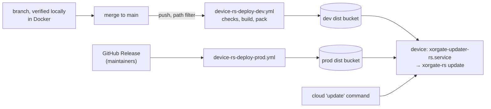

# 7. Build, package, deploy

How a commit becomes a running agent on a device.



## The release binary

`cargo build --release` uses the profile in the workspace `Cargo.toml`:

| Setting | Why |
|---|---|
| `lto = "fat"`, `codegen-units = 1` | whole-program optimisation: a smaller, faster binary, at the cost of slow release builds |
| `strip = true`, `debug = "line-tables-only"` | small binary, but panics and backtraces still name files and lines |
| no `panic = "abort"` | a panic unwinds, so a panicking task is caught and reported (`AgentCtx::spawn`) instead of killing the whole process |

The binary links GStreamer and glibc dynamically (chapter 1). CI prints the relevant
`ldd target/release/xorgate-rs` lines after every release build so this stays visible.

## Build identity: `build-info.json`

`scripts/build-info.sh <channel> [--version <v>] [--out <path>]` writes
`{"version", "channel", "builtAt", "packageVersion"}`. The agent reads it from `../build-info.json`
next to its executable, reports it in the config report as `effective.agent.build`, and prints it
with `xorgate-rs -v`. The console compares `version` as a plain string with the latest published
build.

| Channel | Made by | `version` |
|---|---|---|
| `dev` | the deploy-dev workflow, for `main` | short commit sha |
| `prod` | the deploy-prod workflow, for a release | the release tag |
| `bench` | `scripts/docker-build.sh pack`, by hand | short sha, `-dirty` if the tree has changes |
| `ci` | `ci.yml` artifacts | never published |

Without a `build-info.json` the binary falls back to the commit baked in by `build.rs` and channel
`dev-local` (`crates/xorgate-agent/src/build_info.rs`).

## `scripts/pack.sh` and the tarball

```sh
scripts/docker-build.sh pack       # build in Docker, then pack with channel bench
# or, with an existing binary:
scripts/pack.sh --channel bench --bin target/docker/release/xorgate-rs
```

Output: `target/dist/xorgate-agent-rs-<version>.tar.gz` and a `.sha256` sidecar in
`sha256sum -c` format. The tarball is laid out exactly as `/opt/xorgate-rs` on the device:

```text
bin/xorgate-rs           the stripped release binary
build-info.json
systemd/                 xorgate-agent-rs.service, xorgate-updater-rs.service (+ bench/, never installed)
install-rs.sh            the converter, so --revert works offline
python/                  the IMU and OBD helpers
modem/                   the modem daemon and its udev/NetworkManager files
media/                   the KVS WebRTC runtime and its libraries
system/                  the sudo helpers and a cron file
```

`pack.sh` refuses to produce a tarball that misses a required member (the binary, the unit, the
Python helpers, `install-rs.sh`), and it verifies the vendored `media/`, `modem/` and `system/` trees
against their `SHA256SUMS` files. A corrupted binary blob then fails the pack, not the first live
view on a device.

## CI workflows (`.github/workflows/`)

Every build job runs on an `ubuntu-24.04-arm` runner inside `container: debian:bookworm`, for the
same reason the local build uses Docker: native aarch64, glibc 2.36, GStreamer 1.22. (Only the
`cargo deny` job runs on a plain x86 runner: it just reads `Cargo.lock`.)

| Workflow | Trigger | Does |
|---|---|---|
| `ci.yml` | **manual only** (`workflow_dispatch`) | fmt, clippy `-D warnings`, tests, the Rust-vs-Rust replay smoke and media smoke, release build, `pack.sh --channel ci` (artifact only), and a separate `cargo deny` job |
| `device-rs-deploy-dev.yml` | push to `main` touching shipped paths (`crates/`, `Cargo.toml`, `Cargo.lock`, `rust-toolchain.toml`, `systemd/`, `scripts/` except `scripts/bench/`, `python/`, `modem/`, `media/`, `system/`, or the workflow file itself; Markdown never triggers it). Also has a manual `workflow_dispatch`. | fmt, clippy, tests, release build, `build-info.sh dev`, pack, upload to the **dev** dist bucket, then an anonymous check of what a device will see |
| `device-rs-deploy-prod.yml` | a **published GitHub Release** (also a manual `workflow_dispatch` with a `tag` input) | the same checks at the tag, `build-info.sh prod --version <tag>`, pack, verify the AWS account, upload to the **prod** dist bucket |

`ci.yml` is manual to save CI minutes: branches are verified locally in Docker before merge, and
`main` is covered by the deploy workflow, which runs the same checks before it publishes anything.
So **a merge to `main` that touches shipped code is a deploy to dev.** Releases and production
deploys are done by the maintainers. **Never dispatch `device-rs-deploy-dev.yml` or
`device-rs-deploy-prod.yml` by hand**, and do not create releases. Dispatching `ci.yml` on a branch
(`gh workflow run ci.yml --ref <branch>`) is harmless, since it uses no secrets and publishes
nothing, but it costs CI minutes: ask first.

What gets uploaded, and the guard rails:

- The versioned tarball and its sidecar (cached forever), the `xorgate-agent-rs-latest.tar.gz`
  alias and sidecar, `install-rs.sh` and its sidecar, and `latest-rs.json` last.
- Every key goes through `scripts/dist-guard.sh`, an allow-list of the Rust agent's keys only. The
  same buckets hold the reference agent's builds (`latest.json`, `xorgate-agent-*.tar.gz`), and the
  guard makes it impossible for this repo to overwrite them.
- `latest-rs.json` is produced by `scripts/dist-manifest.sh`, whose output bytes are frozen and
  tested (`scripts/tests/dist.sh`).
- `scripts/dist-check.sh` then fetches everything anonymously, as a device would, checks every
  sidecar, and confirms the reference agent's `latest.json` did not change.

## On the device

| Path | What |
|---|---|
| `/opt/xorgate-rs/` | the unpacked tarball |
| `/usr/local/bin/xorgate-rs` | a two-line wrapper: sets `XORGATE_HOME=/var/lib/xorgate` by default and execs the binary, so the CLI reads the running service's state |
| `/etc/systemd/system/xorgate-agent-rs.service` (+ `.d/10-user.conf`) | the agent unit, run as the provisioning user |
| `/etc/systemd/system/xorgate-updater-rs.service` (+ `.d/10-dist.conf`) | the one-shot updater |
| `/etc/sudoers.d/024_xorgate-update-rs` | lets the agent start exactly the updater unit, nothing else |
| `/usr/local/bin/xorgate-camcfg` (+ `xorgate-camcfg.overlays`) | the camera-line owner: the root helper through which the agent changes the camera `dtoverlay=` lines of `config.txt`, and its allow-list: the overlay names it may write and, per overlay, the parameter names (generated from the sensor catalog). It builds every line itself from checked parts and never reboots |
| `/etc/sudoers.d/025_xorgate-camcfg` | lets the agent run that helper, nothing else |
| `/var/lib/xorgate/camera-boot-lines.json` | each camera port's `dtoverlay=` line as the agent first saw it in the current boot (keyed by the kernel's boot id). A line that differs now waits for a reboot. Rust-only; rewritten once per boot; safe to delete |
| `/var/lib/xorgate-packages/camera-packages.json` | root-owned: which extra OS packages `xorgate-rs camera requirements --install` put there for a camera sensor, and the versions it replaced (for a rollback by hand). Its download directories (`download-XXXXXX`, mode 0700) exist only while a download runs |
| `/etc/xorgate/` | identity, `agent.env`, manifests: shared with the reference agent, read-only for the converter |
| `/var/lib/xorgate/` | settings and state: shared with the reference agent |

## Converting a device: `scripts/install-rs.sh`

Devices are provisioned with the reference agent and then **converted**. `install-rs.sh` ships at
the root of every tarball and as a key in the dist bucket. The operator runbook is
[`docs/convert.md`](../docs/convert.md). The essentials:

```sh
sudo bash install-rs.sh [--from <bucket-url>] [--tag <ver>] [--tarball <file>] [--reinstall] [-y]
sudo /opt/xorgate-rs/install-rs.sh --status            # converted | converting | reverted | not-converted
sudo /opt/xorgate-rs/install-rs.sh --revert            # back to the reference agent; Rust files kept
sudo /opt/xorgate-rs/install-rs.sh --revert --purge    # … and delete what the conversion installed
```

- **Convert** downloads and verifies the tarball (or takes `--tarball` offline), smoke-runs the
  staged binary, installs only Rust-owned paths, records the previous state in
  `/var/lib/xorgate-rs-install`, then disables the reference agent's unit and starts the Rust one.
  If the Rust agent is not healthy after its start and a verification window (up to 150 s each),
  the script reverts by itself and exits 4.
- **Revert** needs no network and no working Rust binary. It restores the reference agent's
  enablement from the record, starts it, and compares the reference agent's files with the
  pre-conversion manifest.
- **Rollback is always possible** because the reference agent is stopped and disabled, never
  removed.
- It never touches `/etc/xorgate`, the reference agent's install and units, the modem daemon, or
  any file it did not install. It is plain bash with only the tools a Bookworm device already has.

Exit codes: 0 done, 1 failed (device back where it was), 2 usage, 3 refused (precondition), 4 the
Rust agent was unhealthy and the script reverted. `docs/convert.md` has the troubleshooting table.

Test it with `scripts/tests/install-rs-unit.sh` (fast, in a throwaway container),
`scripts/tests/install-rs-systemd.sh` (real systemd) and `tools/convert-e2e/` (the full matrix).

## The updater

The cloud's `update` command (or the console's update button) makes the agent run
`sudo -n systemctl start --no-block xorgate-updater-rs.service`. That one-shot unit runs
`xorgate-rs update` (`crates/xorgate-agent/src/cli/update.rs`), which:

1. downloads `xorgate-agent-rs-latest.tar.gz` and its `.sha256` (or `--tag <version>`, or
   `--from <bucket-url>`), and verifies the checksum;
2. unpacks it to `/opt/xorgate-rs.new` and smoke-runs the staged binary;
3. swaps it into `/opt/xorgate-rs`, keeping `/opt/xorgate-rs.old`, which is **restored
   automatically** if any later step fails;
4. reinstalls the units, the wrapper, the updater unit and the sudoers grant (and the shared modem
   and system assets only on a device that no longer has the reference agent);
5. runs the NEW build's `xorgate-rs camera requirements --install --no-restart --quiet`: the
   extra OS packages a declared camera sensor needs (next section). It prints nothing when
   nothing is to do, and it never fails the update;
6. reloads systemd and restarts the agent, only if it was running.

All the decisions and every file body are in `xorgate_core::update_plan`; `update.rs` is only the
I/O, with a timeout on every tool it runs. It requires root. By hand:
`sudo systemctl start xorgate-updater-rs && sudo journalctl -u xorgate-updater-rs -n 50`.

One caveat from the runbook: `agent.env` may pin `DEVICE_DIST_VERSION` to a reference-agent build.
The updater unit's drop-in `10-dist.conf` overrides it to `latest`. A hand-run
`sudo xorgate-rs update` does not see that drop-in, so pass `--tag latest`.

Test it with `tools/update-e2e/run.sh`, which uses a local fake bucket.

### The extra packages of a sensor

Some sensors need OS packages the stock image does not have. Today that is one case: the IMX335
needs Arducam's libcamera build (two packages, `libcamera0.5` and `libcamera-ipa`, that replace
the stock ones of the same name). Which packages, in which version, from which URL, with which
sha256 and size is pinned in the sensor catalog (`crates/xorgate-core/data/camera-catalog.json`,
`packageSets`), per OS release and architecture. The catalog is compiled into the binary.

```sh
xorgate-rs camera requirements                 # anyone: what the declared sensors need, required and installed versions
sudo xorgate-rs camera requirements --install  # root: install what is missing, hold it, restart the agent
#   --from-claim <claim.json>   the sensors of a claim response instead of the held cameraSensors setting
#   --no-restart                do not restart the agent afterwards
#   --quiet                     print only what was changed or what failed
```

Exit codes: 0 nothing is needed or everything is in place; 1 something is missing (listing) or
an install did not succeed; 2 usage or an unreadable claim; 3 refused for this device (the
catalog lists no packages for its OS release and architecture, or an entry is not usable).

**The unprivileged agent never installs anything.** It reports `requirements-missing` with the
package names and "run `sudo xorgate-rs update` on the device (the console's Update button does
the same), or `sudo xorgate-rs camera requirements --install`". Three things run the install, all
as root: the provisioner (step 8c, with the claim, before the agent starts), `xorgate-rs update`
(step 5 above, so the console's Update button installs them), and a person at a shell. In the
first two a failure is a `WARN` line and nothing more: the device is as it was, and the next
update tries again.

What `--install` does (`cli/camera_packages.rs`; the plan and every check are in
`xorgate_core::camera_packages`, the download in `xorgate_cloud::fetch`):

1. **Refuses** in one sentence when the catalog has no packages for this OS release and
   architecture, or a pinned entry is not plain. Nothing is changed.
2. **Downloads** each missing package over HTTPS from the catalog's URL into a new directory under
   `/var/lib/xorgate-packages` that only root can read. The URL's host must be `github.com` (the
   backend's `CAMERA_PACKAGE_HOSTS`). GitHub answers a release-asset download with a redirect to
   its asset store, so a redirect is followed only to `github.com`,
   `release-assets.githubusercontent.com` or `objects.githubusercontent.com` (the store's earlier
   name), over HTTPS, at most four times; the HTTP library itself follows none. No credentials,
   no proxy. Bounds: 20 s to connect, 30 s between reads, 5 minutes in all, and never more bytes
   than the catalog's `bytes`.
3. **Verifies** size and sha256 against the pin BEFORE anything is installed. A file that is not
   the pinned one is refused. The directory is removed on every path, so no partial file stays.
4. **Asks apt first**: `apt-get -s install <those files>` (a simulation) and reads the plan. Apt
   may install the pinned packages in the pinned versions and nothing else, and remove nothing;
   otherwise the install is refused before the system is touched.
5. **Installs** exactly those files with `apt-get install` in one transaction, checks with
   `dpkg-query` that the versions are now the pinned ones, and writes what it replaced to
   `/var/lib/xorgate-packages/camera-packages.json`.
6. **Holds** the packages (`apt-mark hold`) when the set says so.
7. **Restarts the agent** (`systemctl try-restart`, so only if it runs) unless `--no-restart`:
   the camera is then listed within seconds. Without the restart it appears at the agent's next
   camera re-listing, at most five minutes later. No reboot is needed either way.

It is idempotent: a set that is installed and held costs no download and no apt call. It never
runs a script of the package's vendor (Arducam's install script pulls in about 200 packages and
runs remote shell code), never adds an apt source, and passes no catalog string to a shell:
every tool is run with an argument vector and a fixed environment
(`PATH=/usr/sbin:/usr/bin:/sbin:/bin`, `DEBIAN_FRONTEND=noninteractive`, `LC_ALL=C`), by absolute
path (`/usr/bin/apt-get`, `/usr/bin/apt-mark`, `/usr/bin/dpkg-query`).

**The hold and a later `apt upgrade`.** The stock `libcamera0.5` and `libcamera-ipa` come from the
Raspberry Pi apt repository, and a newer stock version would replace Arducam's build on the next
`apt upgrade` and take the IMX335 helper with it. The hold prevents that: apt keeps the two
packages back and says so ("The following packages have been kept back"), and it also keeps
back whatever needs the newer libcamera (`gstreamer1.0-libcamera`, as seen on bench 2). The rest
of the upgrade goes through. The cost: that device gets no stock libcamera fixes until the
catalog pins a newer build and the agent is updated (the update then installs over the hold,
`--allow-change-held-packages`, and holds again). Someone who runs `apt-mark unhold` or
`apt full-upgrade` by hand and loses the packages sees the port turn `requirements-missing`
again; the next `xorgate-rs update` puts them back.

**Going back to the stock packages** is done by hand (there is no `--remove`): the listing prints
the two commands, from the record of what it replaced.

```sh
xorgate-rs camera requirements        # ends with "to go back: …"
sudo apt-mark unhold libcamera0.5 libcamera-ipa
sudo apt-get install --allow-downgrades libcamera0.5=<replaced version> libcamera-ipa=<replaced version>
```

If apt no longer offers the replaced version, take the one `apt-cache policy libcamera0.5` shows
as the candidate of the Raspberry Pi repository and install that with the same command. Then
choose another sensor for the port, or the next update installs the set again.

**A first update INTO this build does not install them yet.** `xorgate-rs update` is run by the
build that is being replaced, and a build before this one has no such step. The port then reads
`requirements-missing` with the advice above; a second update (or the command by hand) installs.

### Before releasing a build that brings the camera-line owner

The first build with `xorgate-camcfg` (the one after v0.1.1) reaches a fielded device in two
updates: the first is run by the old updater, which does not install the helper or its grant; the
second installs them. Between the two, a device that needs a camera-line write reports
`cameraMount` `rejected` ("the xorgate-camcfg helper is not installed on this device yet …") and
changes nothing.

After the second update the agent **writes `config.txt` by itself, with no new request**, on every
device whose stored `cameraMount` is not yet what its camera line says. The picture then turns at
the next reboot. That is what the setting asks for, but on a device that has sat in another state
for months it is a surprise. So, before the release, list the Rust devices and look at two groups:

1. **Devices whose `cameraMount` status is not `applied`** (`rejected`, `write-failed`, `adjusted`).
   v0.1.1 could leave such a request unapplied for ever (no `dtoverlay` tool to ask, the
   `xorgate-camrotate` helper or its grant missing). This build applies it.
2. **Devices with a camera line that is not `imx290` and a `cameraMount` that is not 0.** v0.1.1
   took the mount for the device-tree rotation; this build adds the overlay's own default (180 for
   IMX219, IMX708 and IMX335). An IMX708 with `cameraMount` 180 and a line saying `rotation=180`
   gets `rotation=0`.

The exact rule: the rotation a camera line gives is its one `rotation=` token read as a number,
or the overlay's default when it has no token. A write follows for a managed camera when that is
not (the overlay's default + its `cameraMount`) mod 360, or when the line has two `rotation=`
tokens or one that is not a number. The write is withheld, with a `rejected` status that says why,
when the camera report does not confirm the camera on the port, when two lines configure the port,
or when the line sits under a section the agent cannot evaluate.

For each device in the two groups, decide before the release whether the stored setting is the
one wanted, and correct it in the console if it is not. Nothing has to be done on the device.

## The bench scripts (`scripts/bench/`)

The maintainers keep a bench device. The bench scripts can run the Rust agent next to a reference
agent there, on a **separate development identity** and its own state directory (the
`systemd/bench/90-bench-dev.conf` drop-in), or on a converted bench. Check the bench's current
state with `status.sh` before assuming either. The scripts run from your machine over SSH (`BENCH=pi@<bench-host>`) and are idempotent:

| Script | Does |
|---|---|
| `install.sh <tarball>` | install or update the Rust agent on the bench from a packed tarball |
| `start.sh`, `stop.sh`, `status.sh`, `logs.sh` | control and inspect the Rust unit; the reference agent is left alone |
| `profile.sh shared\|exclusive` | which inputs the Rust agent may use: "shared" ones only, or all hardware during an exclusive window |
| `exclusive.sh begin\|end` | an exclusive window: the reference agent is stopped so the Rust agent owns the GNSS port, IMU and cameras |
| `tape-pull.sh` | copy recorded tapes from the bench (they hold location and SIM data: never commit them) |
| `soak.sh`, `evidence.sh`, `shm-audit.sh`, `filler.sh`, `gate-seam.sh`, `ntp-unsync.sh`, `drive-blackbox-ctl.sh`, … | gate and soak tooling; each explains itself in its header |

Bench access, exclusive windows and soaks are the maintainers' call. Two rules to remember even if
you never touch it: **never build on the bench** (use a tarball; `install.sh --from-bench-build` now
refuses, see chapter 1), and keep soaks short unless agreed otherwise. Bench tooling is never
packed or shipped (`scripts/bench/` is excluded from the deploy trigger).
